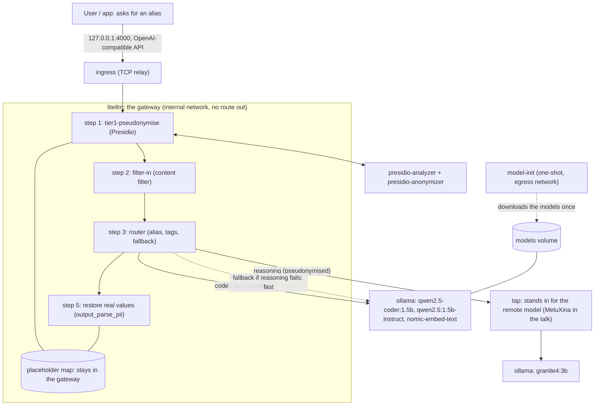

# Architecture

## How a request flows

1. The app sends an OpenAI-compatible request to `http://127.0.0.1:4000` and names
   an **alias** (`reasoning`, `code`, `fast`, `embed`), never a URL.
2. `ingress` passes the bytes to `litellm`. It is a relay that only exists because
   Docker cannot publish a port from an internal-only network.
3. **Guardrails, in file order** (LiteLLM runs them in the order of `config.yaml`):
   - `tier1-pseudonymise` (steps 1 and 5): LiteLLM sends the text to
     `presidio-analyzer`, then replaces each finding with a numbered placeholder,
     for example `<PERSON_1>`. The placeholder-to-value map is kept in the
     request's in-memory metadata inside the gateway process.
   - `filter-in` (step 2): local regex and keyword checks. An AWS key or a
     jailbreak phrase means HTTP 400. An IBAN-shaped string that is still in the
     text is masked one way as `[IBAN_REDACTED]`.
   - The order matters: pseudonymise runs first (step 1) so that a valid IBAN
     gets a *restorable* Presidio placeholder rather than a one-way mask. Filter
     in runs second (step 2). Both still run before any model is called.
4. **Router** (step 3): the alias picks the deployment. Tags in the request
   (`metadata.tags`) are matched to deployment tags when an alias has several
   deployments. If `reasoning` fails, the router retries the request on `fast`.
5. **Filter out** (step 4) is not configured in the kit (see Limitations in the
   README).
6. **Restore** (step 5): `output_parse_pii: true` replaces the placeholders in the
   answer (streaming and non-streaming) with the real values, then the map is
   dropped with the request.

## Networks

- `internal` (`internal: true`): litellm, tap, ollama, presidio-*. No route out.
- `edge`: ingress only (port publishing).
- `egress`: model-init only (model download). It runs its own Ollama server on
  127.0.0.1 inside its container to write into the shared `models` volume, so the
  serving `ollama` never needs internet access.
- `docker-compose.remote.yml` adds `remote-egress` to litellm when you point
  `reasoning` at a real remote endpoint.
